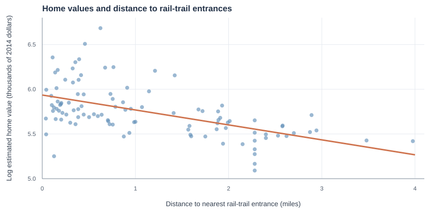

# Rail-Trail Proximity and Home Values

**A multiple linear regression analysis of residential property values in Northampton, Massachusetts.**

**Authors:** Gaku Aihara and Richard Jiang  
**Project type:** Academic statistical analysis (R / Quarto)  
**Research question:** Are homes closer to rail-trail entrances associated with higher home values, after accounting for other property and neighborhood characteristics?

## Overview

This project investigates whether proximity to a rail-trail entrance is associated with the estimated value of a home. We analyzed data on **104 homes in Northampton, Massachusetts, in 2007**, using exploratory data analysis and multiple linear regression. The analysis was framed as a recommendation to a hypothetical real-estate development client, **Acme Homes, LLC**.



*Unadjusted exploratory plot of log home value versus distance to a rail-trail entrance. The adjusted association reported below comes from a multiple linear regression model, not the trend line in this plot.*

## Key finding

After adjusting for square footage, garage spaces, number of bedrooms, ZIP code, and Walk Score, **each additional mile from the nearest rail-trail entrance was associated with approximately 4.5% lower estimated home value**.

| Estimate | Value |
| --- | ---: |
| Distance coefficient (log-home-value model) | -0.046 |
| Approximate change in home value per additional mile | -4.5% |
| 95% confidence interval for the percentage change | -8.4% to -0.4% |
| Reported *p*-value | 0.032 |
| Homes analyzed | 104 |

**Interpretation:** In this sample, otherwise similar homes farther from trail entrances tended to have lower estimated values. This is an **observational association**, not evidence that building a rail trail would cause property values to increase. Regression diagnostics also raised concerns about nonconstant residual variance, so the reported confidence interval and significance test should be interpreted cautiously.

## Methods

- **Exploratory data analysis:** Examined the distributions of estimated home values and rail-trail distance, and explored associations with walkability and neighborhood characteristics.
- **Variable selection:** Considered housing and neighborhood factors such as property acreage, square footage, bedrooms, garages, ZIP code, Walk Score, and Bike Score. Because Walk Score and Bike Score were highly correlated (*r* = 0.93), the final model used Walk Score.
- **Regression modeling:** Fit a multiple linear regression with log-transformed estimated home value as the response and distance to the nearest rail-trail entrance as the main predictor.
- **Model checks:** Considered a quadratic distance term and reviewed residual diagnostics, including normality, variance patterns, and influential observations.
- **Business interpretation:** Interpreted the regression results in the context of potential residential development decisions.

## Files

| File | Description |
| --- | --- |
| [`rail-trail-home-value-analysis.pdf`](rail-trail-home-value-analysis.pdf) | Complete eight-page report, including figures, regression results, and conclusions |
| [`rail-trail-home-value-analysis.qmd`](rail-trail-home-value-analysis.qmd) | Quarto source file containing the report text and R analysis code |
| [`Rail.trails.csv`](Rail.trails.csv) | Original course-provided dataset (104 homes) used by the analysis; kept in this private repository |
| [`figures/rail-trail-vs-home-value.svg`](figures/rail-trail-vs-home-value.svg) | Recreated unadjusted scatterplot with a linear trend based on the supplied dataset |

## Reproducing the analysis

The `.qmd` source uses **R** and **Quarto**, with R packages including `tidyverse`, `ggplot2`, `gt`, `gtsummary`, `knitr`, `kableExtra`, and `patchwork`. Rendering to PDF also requires a working LaTeX installation.

The dataset **`Rail.trails.csv` is included** alongside the `.qmd`, so its relative file path is ready for the code. With the listed R packages and a LaTeX installation, run:

```bash
quarto render rail-trail-home-value-analysis.qmd --to pdf
```

The PDF is the original uploaded report and can be viewed without reproducing the analysis. Rendering results can also depend on installed R / Quarto package versions.

**Dataset caution:** The course-provided CSV includes property street addresses and geographic coordinates. This repository is currently private. Before making it public or sharing the dataset, confirm that redistribution is permitted and consider excluding or anonymizing identifying columns.

## Limitations

The data cover 104 homes from only two ZIP codes in 2007, so the findings may not generalize to other housing markets or to current conditions. Unobserved factors such as property condition, crime rates, or other nearby amenities may be related to both distance from trails and home value. The residual diagnostics suggested heteroskedasticity, which can affect the reliability of the standard errors, confidence intervals, and *p*-values.

## Credits

This was a **collaborative academic project by Gaku Aihara and Richard Jiang**. The report and Quarto source are preserved with both authors credited. The analysis was completed as a class assignment; it was not a consulting engagement with an external client.